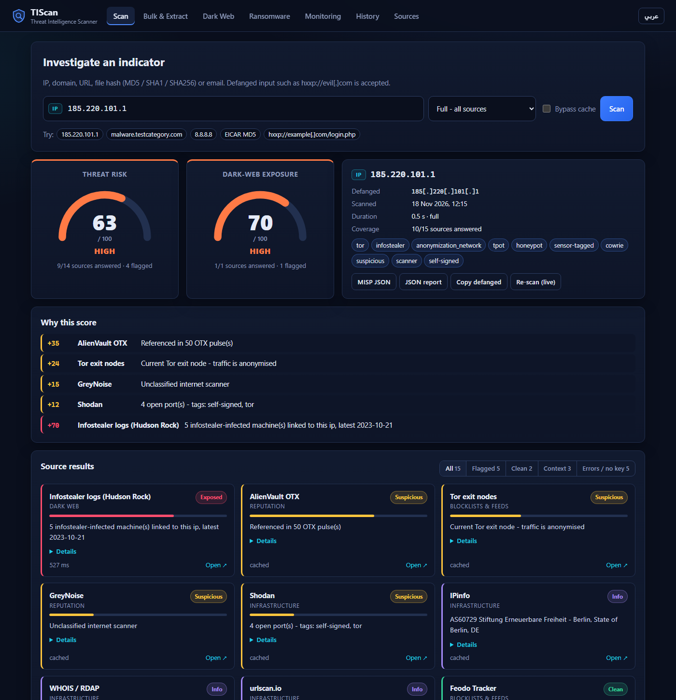
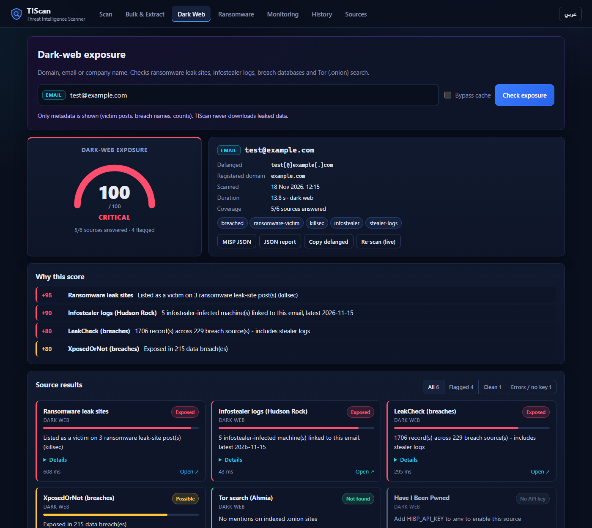
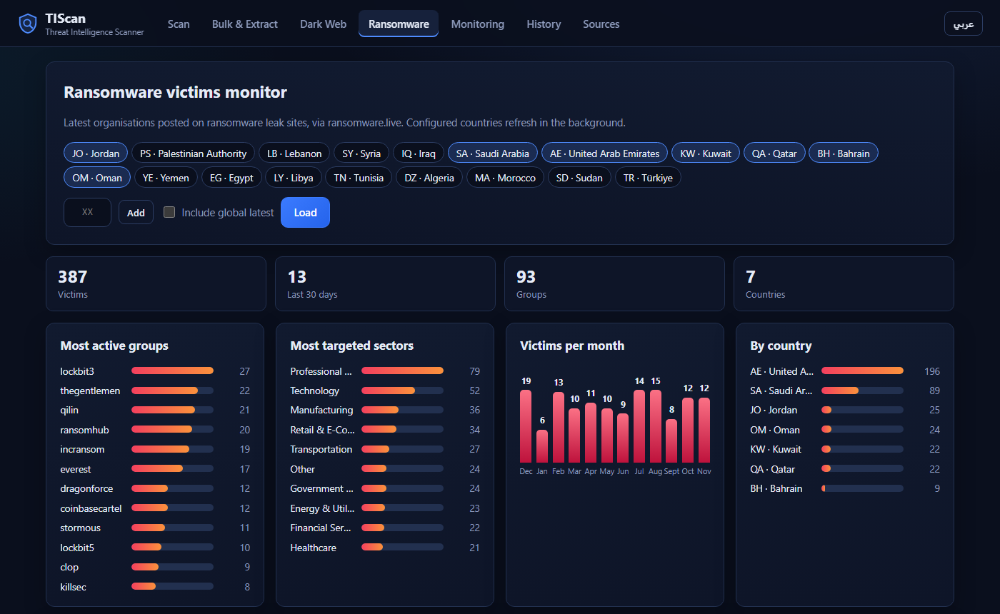
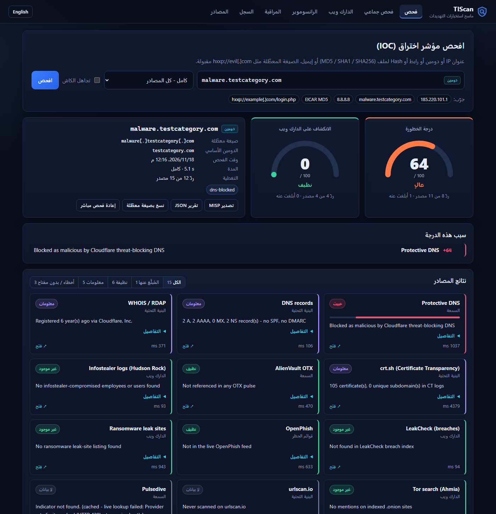

# TIScan: Threat Intelligence and Dark-Web Exposure Scanner


TIScan gives a SOC analyst one verdict for an indicator instead of seventeen browser tabs.
Paste an IP, domain, URL, file hash or email. TIScan queries **27 intelligence sources in
parallel**, streams each result into a dashboard as it arrives, and combines them into two
explainable scores:

* **Threat risk (0–100)**: how malicious the indicator is, from reputation engines, abuse.ch, blocklists and protective DNS.
* **Dark-web exposure (0–100)**: whether the organisation or person appears on ransomware leak sites, in infostealer logs, in breach databases or on Tor (.onion) sites.

Built for blue-team work, with a bilingual dashboard (English / العربية), MISP export and
Wazuh alert enrichment.



---

## Features

| | |
|---|---|
| **Single-IOC investigation** | IP, domain, URL, MD5/SHA1/SHA256, email. Accepts defanged input (`hxxp://evil[.]com`). Results stream in live, source by source. |
| **Explainable scoring** | A weighted noisy-OR model combines the sources. A "Why this score" panel lists each source's contribution. Known-good signals such as allow-lists, RIOT and NSRL reduce false positives. A benign signal never cancels a strong hit. |
| **Dark-web exposure** | Ransomware leak-site victim posts (ransomware.live), infostealer infections of employees and customers (Hudson Rock), breach databases (LeakCheck, XposedOrNot, HIBP), and .onion search (Ahmia). Only metadata is collected. |
| **Continuous monitoring and alerts** | Put your domains, key emails, public IPs or company name on a watchlist. TIScan re-scans them on a schedule (every 24 h by default) and alerts only on **new** findings: a new ransomware leak post, more infostealer-compromised employees, a new breach, a new Tor mention, a new blocklisting, or a risk level that rises. Alerts are sent by **email** (Gmail or any SMTP server). Telegram is not used because it is blocked in Jordan. |
| **Ransomware monitor** | Latest leak-site victims for Jordan and the GCC by default, or any country. Shows the most active groups, targeted sectors and a monthly trend. Refreshes in the background. |
| **Bulk scan and IOC extraction** | Paste a phishing email with headers, proxy logs or a threat report. TIScan extracts, refangs and de-duplicates every IOC, filters out file names such as `invoice.pdf`, flags private IPs, then scans them all. Results export to CSV. |
| **Pivoting** | Each scan lists related indicators: DNS A/MX/NS records, CT-log subdomains, passive DNS, hosting IPs, C2 servers of a malware sample. Select them and scan them in one click. |
| **MISP** | Export any scan, or many scans, as a MISP event JSON with typed attributes, `to_ids`, TLP and tags. Push it directly to your MISP instance. |
| **Wazuh** | A custom integration enriches Wazuh alerts with TIScan verdicts and raises level 7, 12 or 14 alerts. See [`integrations/wazuh`](integrations/wazuh/README.md). |
| **Caching and quotas** | SQLite cache with per-source TTLs. Stale results are served when a provider is down or rate-limited. Built-in rate limiters protect free tiers, such as VirusTotal's 4 lookups per minute. |
| **History** | Every scan is saved and can be reopened, searched, deleted or exported. |
| **REST API and CLI** | Interactive API docs at `/api/docs`. Run `python -m tiscan scan <ioc>` from a terminal. |

## Screenshots

| Dark-web exposure | Ransomware victims monitor |
|---|---|
|  |  |

| Arabic interface (RTL) |
|---|
|  |

## Sources

21 of the 27 sources work **without any API key**. The other 6 need a key, and all of those keys except HIBP are free.

| Category | Source | Key |
|---|---|---|
| Reputation | VirusTotal | free key |
| | AbuseIPDB | free key |
| | AlienVault OTX | optional |
| | GreyNoise Community | optional |
| | Pulsedive | optional |
| | Protective DNS (Cloudflare 1.1.1.2 + Quad9) | none |
| abuse.ch & blocklists | URLhaus · ThreatFox · MalwareBazaar | one free abuse.ch key |
| | Feodo Tracker (botnet C2) | none |
| | Spamhaus DROP | none |
| | OpenPhish | none |
| | Tor exit nodes | none |
| | CIRCL hashlookup (known-good files) | none |
| Infrastructure | DNS records + SPF/DMARC | none |
| | WHOIS / RDAP (domain age) | none |
| | crt.sh certificate transparency | none |
| | IPinfo | optional |
| | Shodan (InternetDB without key) | optional |
| | urlscan.io | optional |
| | Email domain checks (MX/SPF/DMARC, disposable) | none |
| Dark web | Ransomware leak sites (ransomware.live) | none |
| | Infostealer logs (Hudson Rock Cavalier) | none |
| | LeakCheck | none |
| | XposedOrNot | none |
| | Have I Been Pwned | paid key |
| | Tor search (Ahmia) | none |

## Getting your API keys

> **TIScan does not include any API keys.** Each user signs up with the providers below and
> uses their own keys. Your lookups count against your own free quota, and nobody else can see them.

21 sources work with no key at all. The three ⭐ keys unlock most of the value. All are free except HIBP.

| | Provider | What the key unlocks | Get it here | `.env` variable |
|---|---|---|---|---|
| ⭐ | **VirusTotal** | 70+ antivirus engines for IPs, domains, URLs and hashes (free: 4 lookups/min, 500/day) | [virustotal.com/gui/join-us](https://www.virustotal.com/gui/join-us), then *your profile → API key* | `VT_API_KEY` |
| ⭐ | **AbuseIPDB** | Abuse reports for IPs (free: 1,000 checks/day) | [abuseipdb.com/register](https://www.abuseipdb.com/register), then *Account → API* | `ABUSEIPDB_API_KEY` |
| ⭐ | **abuse.ch** | URLhaus, ThreatFox and MalwareBazaar: one key for all three | [auth.abuse.ch](https://auth.abuse.ch/), then *Optional → Auth-Key* | `ABUSECH_API_KEY` |
| | AlienVault OTX | Passive DNS for pivoting, higher limits | [otx.alienvault.com](https://otx.alienvault.com/accounts/signup), then *Settings → OTX Key* | `OTX_API_KEY` |
| | Shodan | Full host details (the free InternetDB is used without a key) | [account.shodan.io](https://account.shodan.io/register) | `SHODAN_API_KEY` |
| | GreyNoise | Higher community API limits | [viz.greynoise.io/signup](https://viz.greynoise.io/signup) | `GREYNOISE_API_KEY` |
| | Pulsedive | Higher limits | [pulsedive.com/register](https://pulsedive.com/register) | `PULSEDIVE_API_KEY` |
| | urlscan.io | Higher search limits | [urlscan.io/user/signup](https://urlscan.io/user/signup) | `URLSCAN_API_KEY` |
| | IPinfo | Higher limits | [ipinfo.io/signup](https://ipinfo.io/signup) | `IPINFO_TOKEN` |
| | Have I Been Pwned (paid) | Breach lookups for email addresses | [haveibeenpwned.com/API/Key](https://haveibeenpwned.com/API/Key) | `HIBP_API_KEY` |

**How to add a key**

* **Easiest:** open the **Sources** tab in the dashboard. Every source has a *Get key* link and a field where you paste your key. Click **Save** and the key works immediately, with no restart.
* **Or edit the file:** open `.env` (it is created on the first run) and paste each key right after the `=`, with no quotes or spaces, for example `VT_API_KEY=abc123...`. Then restart TIScan.

Never share your keys and never commit `.env`. It is already listed in `.gitignore`.

## Quick start

**Windows:** double-click `run.bat`.
**Linux / macOS:** run `./run.sh`.

The script creates a virtual environment, installs the four dependencies, creates `.env` from
`.env.example` and opens **http://127.0.0.1:8787**.

Then add your free keys to `.env`. VirusTotal, AbuseIPDB and abuse.ch matter most. Restart TIScan after adding them.

**Docker** (no Python needed):

```bash
cp .env.example .env          # add your API keys here (optional)
docker compose up -d --build
# open http://127.0.0.1:8787
```

Scan history, the watchlist and settings saved from the dashboard live in the `tiscan-data` volume.

Get the code:

```bash
git clone https://github.com/Mhmdjazarah/TIScan.git
cd TIScan
```

You can also download it as a ZIP from the green **Code** button on GitHub.

Manual setup:

```bash
python -m venv .venv
.venv/Scripts/activate        # Windows  (Linux: source .venv/bin/activate)
pip install -r requirements.txt
cp .env.example .env
python -m tiscan              # dashboard
python -m tiscan scan 185.220.101.1 --mode full
python -m tiscan extract suspicious.eml
```

Requires Python 3.10+.

## Monitoring and alerts

Open the **Monitoring** tab, add an asset, then set up email under **Email alerts**:

1. Click **Gmail settings**. This fills in `smtp.gmail.com`, port 587 and STARTTLS.
2. **Username**: your Gmail address.
3. **App Password**: create one at [myaccount.google.com/apppasswords](https://myaccount.google.com/apppasswords) and paste the
   16-character code. Your normal Gmail password will not work. App Passwords need 2-Step Verification.
4. **Send alerts to**: one or more addresses, separated by commas.

A company mail server works the same way. Click **Send test email** to check delivery.

Tick **"Also email a daily status report"** if you want an email after every scheduled check, even
when nothing new was found. That way a quiet inbox never hides a stopped monitor.

> Scheduled checks in the dashboard only run while TIScan is running. For monitoring that keeps going
> while your computer is off, use GitHub Actions (below).

## 24/7 monitoring with GitHub Actions (free)

GitHub can run TIScan's monitoring for you once a day, for free, on its own servers. You get the same
email alerts and daily report, and no server or credit card is needed.

1. Create a new **private** repository on GitHub. It will hold your watchlist and what TIScan has already seen.
2. Add two files to it, copied from [`examples/github-actions`](examples/github-actions):
   * `watchlist.txt`: your domains, emails, public IPs or company names, one per line.
   * `.github/workflows/tiscan-monitor.yml`: the workflow, copied as is.
3. In that repository open **Settings → Secrets and variables → Actions → New repository secret** and add:

   | Secret | Value |
   |---|---|
   | `SMTP_USER` | your Gmail address |
   | `SMTP_PASSWORD` | your Gmail App Password |
   | `ALERT_EMAIL_TO` | where alerts go (comma-separated) |
   | `VT_API_KEY`, `ABUSEIPDB_API_KEY`, `ABUSECH_API_KEY`, … | optional: your API keys |

4. Open the **Actions** tab, choose **TIScan monitor**, and click **Run workflow** to test it. The first run emails
   a baseline summary. After that it runs every day at 08:00 Jordan time (05:00 UTC). It sends a daily report, and
   an alert as soon as something new appears.

The job records what it has seen in `state/monitor-state.json` in your private repo, so each alert is sent once.
If an email fails, the job turns red and GitHub notifies you. That run's findings are retried the next day.
A daily run takes 1 to 3 minutes, well inside the free Actions allowance for private repositories. The first check of each asset sends a *baseline* summary of
what already exists. After that you only hear about changes. Every alert is also kept on the Monitoring page,
along with which channels it reached. The settings are saved in `.env`.

## How the score works

Each source returns a maliciousness score *sᵢ* (0–100) and has a reliability weight *wᵢ*. For
example, MalwareBazaar has a weight of 1.0 and OTX has 0.5.

```
risk = 1 − Π (1 − sᵢ/100 · wᵢ)
```

* One trusted hit is enough on its own. Feodo Tracker listing an IP as a C2 gives ≈ 95.
* Several weak signals add up. A Tor exit node with scanner activity and a few OTX pulses lands in the medium range.
* Low-reliability sources can never push the score to critical on their own.
* If a source vouches that the indicator is known-good (GreyNoise RIOT, OTX allow-list, NSRL file) and there is no strong hit, the score is multiplied by 0.4.

Levels: 0–9 clean · 10–29 low · 30–59 medium · 60–84 high · 85–100 critical.
The dark-web exposure score uses the same formula over the dark-web sources only.

## Architecture

```
tiscan/
├── app.py          FastAPI routes, NDJSON streaming, security middleware
├── engine.py       picks sources per IOC type, runs them concurrently, caches, aggregates
├── scoring.py      risk & exposure models
├── ioc.py          detection, refang/defang, extraction from free text
├── misp.py         MISP event builder + push
├── monitor.py      watchlist scheduler, finding diff, alert builder
├── notify.py       alert delivery by email (SMTP)
├── db.py           SQLite: response cache (with stale fallback) + scan history
├── sources/        one class per source: reputation, abusech, feeds, infra, darkweb
└── static/         dashboard (vanilla JS, no build step, RTL-aware)
integrations/wazuh/ custom integration script + alert rules
tests/              pytest suite (IOC parsing, scoring)
```

Adding a source means writing one class with `types`, `weight` and an async `lookup()` that
returns a `Result`, then adding it to `sources/__init__.py`.

## Security notes

* TIScan binds to `127.0.0.1` by default. It never fetches the suspicious URL itself; it only asks intelligence APIs about it.
* Malicious URLs in results are shown as inert text. Only links to known intel platforms are clickable.
* The API has CSRF protection (a custom header is required), DNS-rebinding protection and a strict CSP.
* If you expose TIScan on a network, set `TISCAN_API_TOKEN`. Remote clients must then send it in the `X-API-Key` header.
* API keys stay in `.env`, which is git-ignored. Never commit it.
* Use it for defensive security and threat intelligence on assets you are responsible for.

## Responsible use

TIScan is a defensive tool. Use it on indicators from your own investigations and on assets
you own or are authorised to assess.

* The dark-web module only collects **metadata**: leak-site post titles, breach names, counts and dates. It never downloads leaked data or credentials.
* Do not use it to profile or track private individuals.
* Each data source has its own terms of service and rate limits. Respect them.

## Tests

```bash
pip install pytest
pytest -q
```

## Credits

TIScan stands on free community intelligence: abuse.ch (URLhaus, ThreatFox, MalwareBazaar,
Feodo Tracker), ransomware.live, Hudson Rock Cavalier, AlienVault OTX, GreyNoise, Pulsedive,
Spamhaus, OpenPhish, the Tor Project, CIRCL, crt.sh, Ahmia, LeakCheck, XposedOrNot,
VirusTotal, AbuseIPDB, Shodan, urlscan.io and IPinfo. Thank you.

## License

[MIT](LICENSE)

---

## بالعربي (تشغيل سريع)

1. شغّل `run.bat` على ويندوز أو `./run.sh` على لينكس.
2. رح يفتح المتصفح على `http://127.0.0.1:8787`.
3. الأداة بتشتغل فوراً بـ21 مصدر بدون أي مفتاح.
4. **مفاتيح الـAPI:** الأداة ما فيها أي مفاتيح جاهزة. كل واحد لازم يعمل حساب مجاني بالمواقع المطلوبة ويجيب مفاتيحه هو. الروابط كاملة بقسم [Getting your API keys](#getting-your-api-keys) فوق. أهم ثلاثة:
   - VirusTotal: [virustotal.com/gui/join-us](https://www.virustotal.com/gui/join-us)
   - AbuseIPDB: [abuseipdb.com/register](https://www.abuseipdb.com/register)
   - abuse.ch: [auth.abuse.ch](https://auth.abuse.ch/)

   أسهل طريقة: افتح تاب **المصادر** بالداشبورد، والصق كل مفتاح بخانته، واضغط **حفظ**. المفتاح بيشتغل فوراً بدون إعادة تشغيل.
5. اللغة بتتغير من زر "English / عربي" فوق.
6. للمراقبة: افتح تاب "المراقبة" وحط دومين شركتك. بعدها اضبط التنبيهات على الإيميل (Gmail مع App Password). تيليجرام مش مستخدم لأنه محجوب بالأردن.
7. **مراقبة 24 ساعة والجهاز طافي:** GitHub Actions بتشغّل المراقبة ببلاش كل يوم الساعة 8 الصبح بتوقيت الأردن، وبتبعت الإيميل. الخطوات بقسم [24/7 monitoring with GitHub Actions](#247-monitoring-with-github-actions-free).
